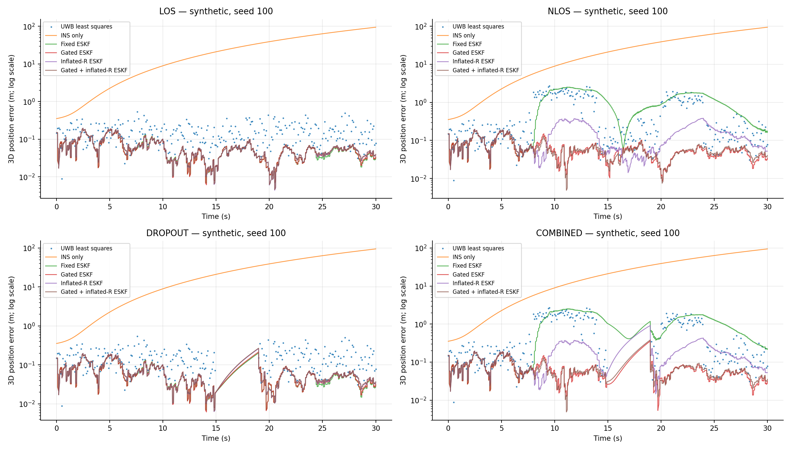

> **稿件状态。** 本工作稿延续所提供硕士开题报告的研究内容一。英文为权威主稿，本文件为对应中文译稿。本成果是初步的可复现研究基线，尚未完成真实无人机验证。方法组合的新颖性尚未确立。作者署名、目标期刊或会议以及最终投稿格式仍需确定。

# 摘要

当卫星导航不可用且无线测量退化或中断时，室内无人机仍需要连续状态估计。本文建立一个可复现基线，将超宽带（UWB）测距与惯性测量通过三维误差状态扩展卡尔曼滤波器融合。估计状态包括位置、速度、姿态及惯性传感器零偏。标量测距更新利用归一化新息剔除严重不一致的观测，或在规定范围内增大测量方差。固定协方差融合、仅门限剔除、仅方差膨胀、纯 UWB 多边定位及纯惯性递推构成对照方法与消融实验。受控合成研究分别考察视距测距、正测距偏差、UWB 完全中断及其组合。在规定 NLOS 轨迹的十次噪声实现中，共同观测时刻的平均定位 RMSE 为：组合规则 0.0666 m、固定融合 1.1345 m、仅门限方法 0.0657 m；方差膨胀的额外增益尚未确立。实现还提供基于 AES-256-GCM 的遥测传输保护，并明确会话与防重放规则。定位鲁棒性与通信保护作为不同属性分别评估：认证加密不能证明测距观测的物理真实性。仓库记录建模假设、可执行配置、来源及实验输出。该成果为研究问题的检验提供基础；合成数据上的性能不能证明真实飞行精度、部署可用性，或相对当代先进方法的优势。

**关键词：** 室内无人机定位；超宽带；惯性导航；误差状态卡尔曼滤波；新息门限；认证加密；可复现性。

# 1. 引言

室内无人机可能无法获得可用的全球卫星导航系统测量。惯性测量单元（IMU）可以支持高频状态递推，但加速度、角速度、初始姿态及传感器零偏中的误差会随积分累积。与已测定位置的 UWB 基站之间的距离提供与位置有关的约束，其效果取决于基站几何、测量时序、标定及传播条件。遮挡路径产生的正测距偏差可能违背常规滤波器的零均值噪声假设。若全部 UWB 观测消失，估计器必须在缺少外部测距校正的情况下递推，其不确定性应随之增加。

所提供开题报告包含 UWB/INS 与 UWB/视觉两个研究方向。本文聚焦 UWB/INS 方向，将原草稿尚不充分的“位置—速度—欧拉角”模型替换为具有明确约定的四元数误差状态模型，并纳入加速度计和陀螺仪零偏。同时，使鲁棒更新规则、基线定义、合成数据生成过程及遥测假设可供检查。视觉与同态加密方向不属于本次实现范围。

本文研究新息驱动的测距处理能否改善指定合成偏差场景下的误差指标、在视距条件下付出何种代价，以及门限剔除和方差膨胀各自的作用。另一个独立问题是在明确网络攻击者模型下，遥测认证保护的实现正确性与开销。本文不假设加密本身能够提高定位精度。

当前版本的贡献是可执行、可审查的基线与评估方案。本文不宣称卡尔曼滤波、新息检验与 AES-GCM 的组合构成新的估计或密码学方法。若要以方法新颖性为投稿主张，还需形成更明确的改进，并与最相关的已有研究比较。

# 2. 相关研究与本文定位

误差状态惯性滤波需要一致的旋转约定、误差注入和协方差重置。Solà 详细讨论了四元数运动学及局部误差状态模型 [@sola2017quaternion]。本文采用右乘局部姿态误差约定，并明确说明实现中的传播与噪声近似。

在本文之前，已有研究使用鲁棒 EKF 处理 UWB 非视距（NLOS）测量，也已有 UWB 融合中的自适应协方差研究 [@bordoy2017robust; @briese2017adaptive]。当前文献审计对这两篇文献仅完成书目元数据核验。它们支持“上述研究方向已有先例”这一有限判断，但不能据此详细重构其方法或宣称相对精度。达到投稿要求的相关研究部分还需阅读全文，并补充近期可复现的竞争方法。

UTIL 数据集为真实无人机评估提供了相关候选来源，包含 UWB 到达时间差（TDOA）、惯性测量及动作捕捉真值 [@zhao2024util]。TDOA 观测是两条距离之差，而非独立的标签到基站距离。它的观测模型及潜在的跨观测相关性与本文标量测距模型不同。因此，论文元数据或数据集可获得性本身不构成本实现的实验证据；使用 UTIL 前必须验证数据适配器并采用正确的测量模型。连续时间 UWB 惯性估计也通过不同的估计框架处理异步测量 [@li2023continuous]，而本文的同步离散时间基线并未实现该方法。

AES-GCM 是标准化的认证加密模式 [@dworkin2007gcm]。AEAD 接口同时认证附加数据和密文，并要求随机数的处理符合所选构造的约束 [@mcgrew2008aead]。密码原语或成功解密均不会自动提供防重放策略，也不会认证物理传播路径；这些职责必须另行处理。

# 3. 状态、传感器与初始化模型

## 3.1. 坐标系与状态

采用东—北—天（ENU）世界坐标系，重力为 $g=[0,0,-9.80665]^T\,\mathrm{m\,s^{-2}}$。位置 $p$ 与速度 $v$ 在世界坐标系中表示。单位四元数 $q$ 表示从机体到世界坐标系的旋转 $R(q)$，实现按 $(x,y,z,w)$ 顺序存储四元数。名义状态为

$$
x=(p,v,q,b_a,b_g),
$$

其中 $b_a$、$b_g$ 分别是机体系中的加速度计和陀螺仪零偏。15 维误差状态为

$$
\delta x=[\delta p^T,\delta v^T,\delta\theta^T,
\delta b_a^T,\delta b_g^T]^T,
\qquad q_{\mathrm{true}}=q\otimes\operatorname{Exp}(\delta\theta).
$$

$\operatorname{Exp}$ 将旋转向量映射为单位四元数；$[u]_\times$ 为满足 $[u]_\times w=u\times w$ 的反对称矩阵。仿真假定基站静止且位置已知、测量时刻同步、UWB 标签与 IMU 之间的杆臂为零。这些是建模假设，并非已完成的标定成果。

## 3.2. 惯性观测与递推

IMU 输出机体系比力与角速度：

$$
f_m=R(q)^T(\ddot p-g)+b_a+n_a,
\qquad \omega_m=\omega+b_g+n_g.
$$

仿真中的白噪声标准差是**每采样点标准差**，不是连续时间噪声密度。零偏增量服从按单位时间平方根给定标准差的随机游走。令 $f=f_m-b_a$、$\omega=\omega_m-b_g$，步长为 $\Delta t$，名义状态使用中点姿态递推：

$$
q_{1/2}=q_k\otimes\operatorname{Exp}(\omega\Delta t/2),
\qquad a^w=R(q_{1/2})f+g,
$$

$$
p_{k+1}=p_k+v_k\Delta t+\tfrac12a^w\Delta t^2,
\quad v_{k+1}=v_k+a^w\Delta t,
\quad q_{k+1}=q_k\otimes\operatorname{Exp}(\omega\Delta t).
$$

名义零偏在预测时保持不变，在测量更新中校正。令 $R=R(q_{1/2})$，实现使用的局部连续时间误差矩阵为

$$
F=\begin{bmatrix}
0&I&0&0&0\\
0&0&-R[f]_\times&-R&0\\
0&0&-[\omega]_\times&0&-I\\
0&0&0&0&0\\
0&0&0&0&0
\end{bmatrix},
\qquad \Phi=I+F\Delta t+\tfrac12F^2\Delta t^2.
$$

对于每采样点加速度与角速度噪声，以及零偏随机游走幅度，定义

$$
D=\operatorname{diag}(\sigma_a^2I,\sigma_g^2I,
\sigma_{ba}^2I,\sigma_{bg}^2I),
\quad
G_d=\begin{bmatrix}
\tfrac12 R\Delta t^2&0&0&0\\
R\Delta t&0&0&0\\
0&I\Delta t&0&0\\
0&0&I\sqrt{\Delta t}&0\\
0&0&0&I\sqrt{\Delta t}
\end{bmatrix}.
$$

预测协方差为 $P^-_{k+1}=\Phi P_k\Phi^T+G_dDG_d^T$。这是明确规定的有限步长近似，并非所有耦合连续时间噪声项的精确离散化。采样率敏感性及更高阶传播有待后续评估。

## 3.3. UWB 观测

对位置为 $a_i$ 的基站，仿真观测为

$$
z_i=\|p-a_i\|+\beta_i+\epsilon_i,
\qquad \epsilon_i\sim\mathcal N(0,\sigma_r^2).
$$

合成偏差 $\beta_i$ 在视距条件下为零，在指定 NLOS 区间内为正。滤波器不能访问 $\beta_i$ 或 NLOS 标签，也不估计独立的 NLOS 偏差状态。其采用 $h_i(x)=\|p-a_i\|$，对应误差状态雅可比为

$$
H_i=\left[\frac{(p-a_i)^T}{\|p-a_i\|}\quad 0\quad0\quad0\quad0\right].
$$

零杆臂假设使直接姿态导数为零。非零杆臂会引入姿态依赖，必须修改观测模型。估计位置与基站重合时该雅可比无定义，不能在此进行有效更新。

## 3.4. 明确的热启动假设与可观测性

仿真使用真实初始位置、速度和姿态加上固定且公开的误差进行初始化。这是受控的**热启动假设**，不是可直接部署的初始化算法。估计器接收扰动后的初值，不接收后续真值或真实零偏；初始零偏估计为零。真实数据评估需要独立合理的初始化器与协方差设置，当前研究不能证明冷启动收敛。

位置信息取决于基站几何。姿态和惯性零偏只能通过运动模型与位置更新受到间接约束，其可观测性取决于运动及初始条件。位置精度不能单独证明偏航角或零偏估计准确。UWB 完全丢失时，即使软件持续输出状态，也不存在外部位置约束。

# 4. 新息驱动的测距处理

## 4.1. 检测与方差膨胀

测距按照固定基站顺序逐个进行标量更新，每个新息均使用该次序下当前可用的状态和协方差计算。基准方差为 $R_0=\sigma_r^2$，定义

$$
\nu_i=z_i-h_i(x^-),\qquad
S_{0,i}=H_iP^-H_i^T+R_0,\qquad
\eta_i=\nu_i^2/S_{0,i}.
$$

$\eta_i$ 为归一化创新平方（NIS）。理想局部标量高斯模型为卡方参考提供依据，但非线性、有偏及自适应滤波器不一定满足这一标定关系。较大值表示模型与观测不一致，不能唯一判定 NLOS：标定误差、时序误差、不良初始化或模型失配也可能产生较大新息。

当 $\eta_i>\gamma_h$ 时，门限规则剔除观测，其中 $\gamma_h=10.827566$。启用方差膨胀时，规则为

$$
\lambda_i=\operatorname{clip}(\eta_i/\gamma_s,1,\lambda_{\max}),
\qquad R_i=R_0\lambda_i,
$$

其中 $\gamma_s=3.841459$、$\lambda_{\max}=25$。门限分别对应常见的标量卡方 99.9% 与 95% 分位数，是固定的开发设置，并非学习所得，也不宣称最优。门限判断使用**膨胀之前**的 $S_{0,i}$。因此，在组合方法中，被接受观测满足 $\lambda_i\leq\gamma_h/\gamma_s\approx2.82$；上限 25 可以在仅膨胀消融方法中生效，但在这些默认参数下不会对组合方法所接受的更新生效。

该有界规则不同于原草稿建议的无界残差外积平滑。它是逐观测鲁棒加权启发式方法，不是测量协方差的一致估计器，也不能证明未知正偏差已得到补偿。过程噪声模型保持固定。

## 4.2. 校正与协方差重置

对被接受的观测，

$$
K_i=P^-H_i^T(H_iP^-H_i^T+R_i)^{-1},
\qquad \widehat{\delta x}=K_i\nu_i.
$$

位置、速度和零偏采用加性校正，姿态采用 $q^+=q^-\otimes\operatorname{Exp}(\widehat{\delta\theta})$ 校正。将局部误差重置为零之前，协方差使用 Joseph 形式更新：

$$
\widetilde P=(I-K_iH_i)P^-(I-K_iH_i)^T+K_iR_iK_i^T.
$$

重置为 $P^+=J\widetilde P J^T$，其中

$$
J=\operatorname{diag}(I,I,J_r(\widehat{\delta\theta}),I,I),
$$

$$
J_r(u)=I-\frac{1-\cos\theta}{\theta^2}[u]_\times
+\frac{\theta-\sin\theta}{\theta^3}[u]_\times^2,
\qquad \theta=\|u\|,
$$

并在数值实现中处理小角度极限。该重置使协方差继续围绕校正后的名义姿态表示 [@sola2017quaternion]。对称化消除浮点非对称性，但不能使错误设定的模型获得统计一致性。

若观测被剔除，则跳过对应更新。若所有测量缺失或被剔除，滤波器依赖惯性递推。重新获取有效观测并不保证成功：漂移足够大后，门限也可能拒绝真实有效的测量。这一失效模式应纳入评估，而非预先排除。

## 4.3. 对照方法与消融

| 仓库标识 | 估计规则 | 目的 |
|---|---|---|
| `uwb` | 不含动态先验的逐时刻非线性最小二乘多边定位 | 纯测距对照；可用距离不足时无输出 |
| `ins` | 从相同热启动初值进行惯性递推 | 不采用 UWB 校正的漂移对照 |
| `eskf` | 使用固定 $R_0$ 的 ESKF | 常规融合参考 |
| `gated_eskf` | 固定 $R_0$ 加 NIS 硬门限剔除 | 单独检验门限作用 |
| `adaptive_eskf` | 有界方差膨胀，不使用硬剔除 | 单独检验逐观测膨胀作用 |
| `robust_eskf` | 硬剔除后进行有界膨胀 | 组合鲁棒基线 |

这些方法在同一框架下实现，并非对具名外部竞争方法的复现。UWB 优化器以上一次成功解作为数值初值，要求至少四个非共面基站；其目标函数仅包含当前距离。所有融合方法共用初始化、过程噪声和传感器数据实现。特别是，相对固定融合的有利结果不足以证明方差膨胀相对仅门限方法具有额外价值。

# 5. 遥测认证保护与威胁模型

考虑能够观察、篡改、注入、丢弃、复制或重排遥测数据包，但无法获得当前会话密钥或攻陷可信端点的网络攻击者。本地传感器测量在遥测加密之前进入估计器。独立模块使用 AES-256-GCM 保护序列化的外发载荷，滤波在可信端点上以明文计算。这不是同态计算。

给定会话密钥 $K$、唯一随机数 $N$、附加数据头部 $A$ 和载荷 $M$，

$$
(C,T)=\operatorname{GCM.Enc}_K(N,M,A),
\qquad
M=\operatorname{GCM.Dec}_K(N,C,T,A)
$$

仅在认证成功时输出明文。参考构造采用由四字节会话前缀和大端 64 位计数器组成的 96 位随机数，并采用 128 位认证标签。每个仅有一个发送者的单向会话必须使用全新 256 位密钥；任一端点重启或状态回滚都必须启用新密钥和新会话。协议将 `version`、`device_id`、`session_id`、`message_type` 和 `counter` 绑定为附加认证数据，使用键排序、无可选空白的 ASCII JSON 编码。接收端先认证，再要求计数器大于已接受水位；允许跳号，但拒绝重复或乱序旧包，包括合法但延迟到达的数据包。无效数据包不能推进防重放状态。计数器耗尽时拒绝发送而非回绕；参考实现还设置默认 $2^{20}$ 条消息预算和 16,384 字节载荷上限。这些应用限制并非完整的部署密钥生命周期策略。

GCM 的机密性与完整性保证依赖其使用假设，包括同一密钥下的随机数唯一性 [@dworkin2007gcm; @mcgrew2008aead]。防重放策略是额外的协议机制。对数据包篡改、错误密钥、重复数据包及状态处理的测试提供实现证据，而非新的安全证明。

该机制不能认证标签与基站之间的物理距离。被攻陷的传感器可以认证错误数值；发生在加密之前的测距操纵不会被加密修复。参考实现未证明能够抵抗 UWB 中继攻击、流量分析、密钥泄露、拒绝服务或不安全的控制决策，也不提供密钥分发、安全存储或部署认证。在提出实时部署主张之前，必须在目标硬件上测量端到端延迟、功耗和内存。

# 6. 实验方案

## 6.1. 合成数据与场景

仿真器生成运动学一致的位置、速度、姿态、机体系比力及角增量。它不是四旋翼动力学模型，也不是电磁传播仿真器。默认时长为 30 s，IMU 频率为 100 Hz，UWB 观测频率为 10 Hz。三维正弦轨迹位于 $10\times8$ m 的水平基站布局内，六个基站高度交替为 0.3 m 和 2.8 m。精确基站坐标、轨迹方程、随机种子及全部参数随可执行配置存储。

默认标准差为：视距测距 0.08 m，每个加速度计采样点 $0.03\,\mathrm{m\,s^{-2}}$，每个陀螺仪采样点 $0.001\,\mathrm{rad\,s^{-1}}$。加速度计与陀螺仪零偏随机游走幅度分别为 $0.0001\,\mathrm{m\,s^{-2}/\sqrt{s}}$ 和 $0.00002\,\mathrm{rad\,s^{-1}/\sqrt{s}}$。滤波器被赋予相同的名义噪声幅度，这些数值并非由标定数据集估计。这一噪声匹配设置也是理想化假设。初始位置误差为 $(0.25,-0.20,0.15)$ m，初始速度误差为 $(0.03,-0.02,0.02)$ m/s，初始局部姿态旋转向量扰动为 $(0.7,-0.5,1.5)$ 度。初始协方差为对角阵，位置、速度、姿态误差、加速度计零偏和陀螺仪零偏各分量的标准差依次为 0.5 m、0.2 m/s、3 度、$0.1\,\mathrm{m\,s^{-2}}$ 和 $0.005\,\mathrm{rad\,s^{-1}}$。这些是合成条件，并非对特定 IMU 或 UWB 产品的测量结果。

| 场景 | 受控扰动 |
|---|---|
| `los` | 仅零均值测距噪声 |
| `nlos` | 在 $[8,14)$ s 对基站 0、1，以及在 $[20,24)$ s 对基站 3，叠加 $0.6+E$ m，其中 $E\sim\operatorname{Exponential}(\text{mean }0.25\,\mathrm m)$ |
| `dropout` | 在 $[15,19)$ s 删除全部 UWB 观测 |
| `combined` | 同时采用上述正偏差与完全中断 |

NLOS 区间持续存在，但其中指数分量对受影响观测独立采样。该简化过程未覆盖真实遮挡的全部时间相关性和跨基站相关性。同一随机种子下，各对照方法使用完全相同的数据集。IMU 噪声、零偏随机游走、测距噪声和 NLOS 扰动使用分离的随机流，因此切换场景不会悄然替换底层 IMU 数据实现。

## 6.2. 指标与统计单位

对时间戳集合 $\mathcal T$ 中的有效估计，定义 $e_k=\|\widehat p_k-p_k\|_2$，以及

$$
\operatorname{RMSE}=\sqrt{\frac{1}{|\mathcal T|}\sum_{k\in\mathcal T}e_k^2}.
$$

尾部误差、最大误差、输出可用率及测距接受/剔除数量补充 RMSE。可用率表示计划时间戳中产生有效数值输出的比例，并不保证输出准确。纯 UWB 方法在可求解的测距时刻输出估计，而惯性与融合方法按 IMU 频率输出。因此，原生输出频率下的误差使用不同时间支持集。跨方法比较还必须使用共同有效的测距时刻，并保留 UWB 中断期间纯 UWB 输出缺失这一事实。

参考方案为每个场景指定十个评估种子 100–109。种子 0–4 预留给标定或开发，但未实现或宣称完成参数拟合。独立仿真运行是统计单位；密集轨迹采样点具有时间相关性，不能作为独立重复。场景汇总采用各运行 RMSE 的均值，以及跨种子的双侧 95% Student-$t$ 区间。两两差值使用同一种子下 `robust_eskf` 的 RMSE 减去对照方法 RMSE，并同样计算 Student-$t$ 区间。比较属于探索性分析，未进行多重比较校正；它们量化的是该生成器下的变化，而不是所有房间、轨迹或无线条件中的不确定性。门限为固定开发选择，尚未使用留出的真实数据集验证。

## 6.3. 可复现性与检查

仓库保留代码、配置、传感器生成假设、数据来源和结果文件。数值检查覆盖测距雅可比及状态约定，受控轨迹检查递推与更新；安全检查单独报告。软件测试通过表示在所测试条件下的行为符合预期，不代表任意运动下收敛、协方差已正确标定或系统安全。

每个数值表格必须由记录在案的运行生成，并指明配置和数据支持集。运行时间测量必须说明平台与计时内容。主机上的 Python 耗时不能证明机载吞吐率或延迟上界。公共数据在进入分析前必须验证单位、时钟对齐、外参及观测语义。

# 7. 结果与证据状态

## 7.1. 合成定位研究

<!-- RESULTS:START -->

参考研究于 2026 年 10 月 23 日完成，包含四个场景、每场景十个配对噪声种子和六个估计器，共 240 次估计器运行。执行清单记录了代码版本 `4686451a6923c579e971c84ba7b5b367b6e814b9`、解析后的配置及源码哈希。写作和结果生成活动使仓库工作区处于非干净状态；记录的估计器、仿真器、几何模块及运行脚本哈希确定了实际执行实现。结果来自同一预设轨迹下噪声与零偏随机游走变化的合成数据，并非 40 次独立真实飞行。

表 1 给出 `common_observed_uwb` 时间戳上各运行定位 RMSE 的均值，单位为米。每个纳入时间戳均至少存在四条观测距离，并且六种方法均输出有限位置估计。全部条目的完整区间保存在 `summary_metrics.csv`。

| 方法 | LOS | NLOS | 中断 | 组合 |
|---|---:|---:|---:|---:|
| `uwb` | 0.1839 | 0.8989 | 0.1873 | 0.9634 |
| `ins` | 40.4813 | 40.4931 | 42.1235 | 42.1378 |
| `eskf` | 0.0594 | 1.1345 | 0.0607 | 1.1860 |
| `gated_eskf` | 0.0597 | 0.0657 | 0.0611 | 0.0679 |
| `adaptive_eskf` | 0.0597 | 0.4609 | 0.0611 | 0.5311 |
| `robust_eskf` | 0.0599 | 0.0666 | 0.0613 | 0.0690 |

LOS 和中断场景的共同支持集分别包含 301 和 261 个时刻。在 NLOS 与组合场景中，UWB 优化器对种子 100 和 107 各有一个时刻未返回成功解。这四个失败解被保留为缺失值，并从共同支持集比较中排除。因此，受影响运行分别具有 300 个 NLOS 时刻或 260 个组合时刻，其余种子保留 301 或 261 个时刻。此条件比较不评估完全中断期间的输出。不同的共同支持集掩码也解释了纯 INS 条目跨场景的小幅变化，尽管同一种子下底层惯性数据相同。

在这些受控正偏差条件下，两种采用硬门限的方法，其共同观测时刻 RMSE 均明显低于固定协方差融合。另一方面，组合规则未证明相对仅门限方法的额外增益。表 2 给出配对平均 RMSE 差及探索性 95% 区间，单位为米；负值有利于组合规则。组合规则相对仅门限融合的小幅正差值，在全部四个场景中的区间均包含零。这些结果支持将门限方法保留为较简单的参考，而不能宣称额外的方差自适应改善了性能。

| 场景 | 组合规则减固定 ESKF | 组合规则减仅门限 ESKF |
|---|---:|---:|
| `los` | 0.0004 [-0.0010, 0.0019] | 0.0002 [-0.0014, 0.0018] |
| `nlos` | -1.0680 [-1.0887, -1.0472] | 0.0009 [-0.0006, 0.0023] |
| `dropout` | 0.0007 [-0.0009, 0.0022] | 0.0003 [-0.0012, 0.0017] |
| `combined` | -1.1170 [-1.1381, -1.0959] | 0.0010 [-0.0005, 0.0025] |

表 3 对组合鲁棒方法在全部 3,001 个 IMU 网格时间戳上评估，其中包含中断期间。尾部和最大误差列是对应各运行统计量的均值，而非合并样本的 95 分位数或全部运行的最坏值。中断与组合场景中更大的密集网格误差表明，条件化的 UWB 时刻表本身不能证明中断期间的连续性或精度。

| 场景 | RMSE 均值 [95% 区间]（m） | 各运行 P95 均值（m） | 各运行最大值均值（m） |
|---|---:|---:|---:|
| `los` | 0.0618 [0.0563, 0.0674] | 0.1154 | 0.1924 |
| `nlos` | 0.0686 [0.0588, 0.0783] | 0.1260 | 0.1984 |
| `dropout` | 0.1020 [0.0829, 0.1210] | 0.2346 | 0.4021 |
| `combined` | 0.1112 [0.0883, 0.1342] | 0.2502 | 0.4376 |

本研究中，惯性与融合方法在全部计划 IMU 时间戳均产生有限状态。100% 数值可用率不意味着估计持续准确，纯 INS 对照即出现明显漂移。纯 UWB 输出自然位于较低的测距频率，并在配置的完全中断期间缺失；其在 100 Hz 网格上的较低可用率本身不是求解器失败率。恢复时间与协方差一致性尚未作为独立结果评估。

{width=100%}

<!-- RESULTS:END -->

报告表格保留了所有方法与场景，包括视距，以及尚未证明优于仅门限方法的结果。较低的平均 RMSE 本身不足以证明可靠恢复、正确标定的不确定性或更好的安全性。种子 100 的代表性诊断日志保留了被剔除的观测；门限后的选择会改变新息分布，不能直接据此作出一致性判断。

## 7.2. 遥测功能与主机开销

`results/security/benchmark.json` 中记录的遥测微基准在 x86-64 主机上运行，主机报告 AMD EPYC 7763 处理器、Python 3.12.14 和 `cryptography` 50.0.0。每种载荷长度先运行 100 个预热数据包，再在单进程中测量 2,000 个数据包。封装计时包含 JSON/AAD 序列化、AES-GCM 和 Base64/包封装编码；解封计时包含解析、标签验证和防重放检查。以下描述性测量不包含网络传输、密钥配置或存储。

| 载荷（字节） | 封装中位数 / P95（$\mu$s） | 解封中位数 / P95（$\mu$s） | 序列化包长度（字节） |
|---|---:|---:|---:|
| 128 | 9.94 / 13.24 | 13.40 / 17.65 | 345–346 |
| 512 | 11.57 / 14.42 | 15.13 / 21.27 | 857–858 |
| 2048 | 18.09 / 23.55 | 23.23 / 48.38 | 2905–2906 |

数据包长度包含示例头部与 Base64 表示，其变化来自计数器编码，而非仅由密码算法扩展决定。同一记录运行拒绝了密文篡改、附加数据篡改、伪造高计数器、错误密钥、重放及乱序投递，并在拒绝时保持防重放状态不变。这些功能检查以及每种载荷长度的一次基准会话不构成密码学证明、独立飞行试验、严格延迟界或机载性能证据。

## 7.3. 定位到遥测的集成检查

独立的四秒合成检查记录于 [定位状态往返记录](../../results/security/localization_roundtrip.json)，将 401 条实际 `robust_eskf` 状态输出送入遥测模块。每条被接受的载荷在解密后均逐字节一致，解码位置变化为零。该演示中，传输前后的定位 RMSE 同为 0.07791 m。在计数器 123 处进行篡改会被拒绝，且已接受水位保持为 122；随后真实数据包 123 可被接受，其重放则被拒绝。序列化状态载荷总计 185,325 字节，对应线路数据包总计 325,844 字节。这是采用独立短场景和种子的集成检查，不是定位研究中的额外重复实验。它保护外发估计，不认证融合前的传感器输入。完全恢复证明传输保真，而非加密带来的精度增益。

# 8. 局限与后续实证步骤

初步研究采用一个轨迹族、理想同步、不含不确定性的已知基站、零杆臂、简化独立传感器噪声、预设正测距偏差及有利的热启动。这些选择便于受控调试，但限制外部有效性。当前没有飞行器动力学、无线信道或闭环飞控模型；所提供实验不能证明真实无人机性能、能耗或飞行安全。

后续评估应改变运动、基站几何、测距质量、偏差持续时间、中断长度、初始化、时间戳误差和标定误差；应测试更长中断，并明确统计重新获取有效观测失败的情况。参数调节必须使用与最终结论评估不同的会话或轨迹。真实数据工作应为所选数据集实现正确观测模型；对于 UTIL，应使用 TDOA，而不能将距离差重新命名为距离 [@zhao2024util]。自行采集飞行数据需要独立参考系统和有记录的坐标系标定。

当前鲁棒规则不对 NLOS 偏差建立概率模型，容易受到仍低于门限的缓慢、貌似合理误差影响。硬剔除也可能延迟漂移后的恢复。同一新息同时用于方差膨胀与更新，使统计一致性更复杂。可观测性及 NEES/NIS 标定需要独立分析，并正确考虑相关选择效应和姿态误差约定。

安全组件假定会话密钥已配置且端点可信。重启、回滚、双向通信、密钥轮换与撤销需要部署协议。数据包认证不验证其中内容的物理测量真实性。这些边界使本文不能声称实现安全测距或全面的无人机安全。

# 9. 结论

本文给出并实现了一个可复现 UWB/INS 研究基线，包括 15 维误差状态滤波器、明确的新息驱动测距处理、共同对照方法、受控合成数据，以及独立限定范围的遥测认证保护。该成果将原研究提纲转化为可检查的数学与软件选择。在所配置合成轨迹中，硬门限方法降低了预设正测距偏差下的误差，而方差膨胀相对仅门限方法的额外收益尚未确立。遥测测试展示了认证状态载荷的完全恢复，以及对所测试篡改和重复消息的拒绝。评估必须在规定的合成与协议假设范围内理解，尚不能证明算法新颖性、真实飞行改进或部署可用性。下一步关键工作是经验证的真实数据适配、与密切相关方法的比较、敏感性分析及目标平台测量。

# 参考文献
